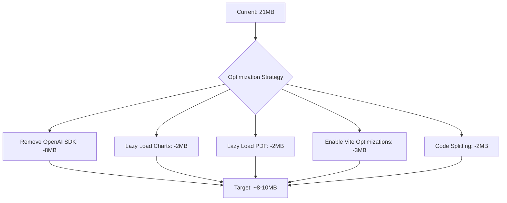

# Web Bundle Size Optimization Plan

## Current State
- **Web Bundle Size:** 21MB
- **Target Size:** ~8-10MB (60% reduction)
- **Issue:** Large dependencies and no build optimizations configured

## Bundle Analysis

### Dependency Size Breakdown (Estimated)

| Dependency | Version | Estimated Size | Impact |
|------------|---------|---------------|---------|
| OpenAI SDK | 6.15.0 | ~8-10MB | 🔴 Critical |
| Recharts | 3.4.1 | ~3-4MB | 🟡 High |
| jsPDF | 3.0.4 | ~1-2MB | 🟡 High |
| jsPDF-autotable | 5.0.2 | ~1-2MB | 🟡 High |
| React | 19.2.0 | ~2-3MB | 🟢 Medium |
| Framer Motion | 11.0.0 | ~1-2MB | 🟢 Medium |
| Other (icons, utils, etc) | ~2-3MB | 🟢 Low |
| **Total** | | **~17-26MB** | |

**Note:** After minification and tree-shaking, actual bundle will be smaller.

## Optimization Strategy



## Action Items

### 1. Remove OpenAI SDK (Critical Impact)
**Status:** 🔴 Critical - OpenAI SDK is ~8-10MB

**Options:**

| Option | Effort | Impact | Description |
|--------|---------|--------|-------------|
| A. Route through Supabase Edge Function | 4h | Removes client SDK entirely |
| B. Use lighter AI alternative | 6h | Replace with smaller library |
| C. Move to server-side only | 8h | Remove all client-side AI |

**Recommended:** Option A - Route through Supabase Edge Function

**Implementation:**
```typescript
// services/aiService.ts
export const parseTransaction = async (
  input: string,
  categories: Category[],
  accounts: Account[],
  people: Person[]
): Promise<ParsedTransaction | null> => {
  // Call edge function instead of using OpenAI client
  const response = await supabaseService.functions.invoke('parse-transaction', {
    body: { input, categories, accounts, people }
  });

  return response.data;
};
```

**Supabase Edge Function:** `supabase/functions/parse-transaction/index.ts`
```typescript
import { serve } from 'https://deno.land/std@0.177.0/http/server.ts';

serve(async (req) => {
  const { input, categories, accounts, people } = await req.json();

  // Use lighter AI SDK or native Deno AI
  const result = await parseAI(input, categories, accounts, people);

  return new Response(JSON.stringify(result), {
    headers: { 'Content-Type': 'application/json' },
  });
});
```

### 2. Lazy Load Recharts (High Impact)
**Status:** 🟡 High - Recharts is ~3-4MB

**Implementation:**
```typescript
// App.tsx - Already lazy loading some views
const InsightsView = lazy(() => import('./components/InsightsView'));

// Add lazy loading for Stats (Analytics) view
const StatsView = lazy(() => import('./components/Stats').then(m => ({ default: m.Stats })));

// Only load when user navigates to Analytics view
```

### 3. Lazy Load PDF Libraries (High Impact)
**Status:** 🟡 High - jsPDF + jsPDF-autotable is ~2-3MB

**Implementation:**
```typescript
// Create dynamic import function
const loadPDFLibs = async () => {
  const [{ jsPDF }] = await Promise.all([
    import('jspdf'),
    import('jspdf-autotable')
  ]);
  return { jsPDF };
};

// Use only when export is needed
const handleExportPDF = async (data: ExportData) => {
  const { jsPDF } = await loadPDFLibs();
  // Generate PDF...
};
```

### 4. Enable Vite Build Optimizations (Medium Impact)
**Status:** 🟢 Medium - Expected ~3MB reduction

**Edit [`vite.config.ts`](vite.config.ts:1):**
```typescript
import path from 'path';
import { defineConfig, loadEnv } from 'vite';
import react from '@vitejs/plugin-react';
import { visualizer } from 'rollup-plugin-visualizer';

export default defineConfig(({ mode }) => {
  const env = loadEnv(mode, '.', '');
  return {
    server: {
      port: 3000,
      host: '0.0.0.0',
    },
    plugins: [
      react(),
      // Bundle analyzer
      visualizer({
        open: false,
        gzipSize: true,
        brotliSize: true,
        filename: 'dist/stats.html'
      }),
    ],
    build: {
      // Minification
      minify: 'terser',
      sourcemap: mode === 'development',
      
      // Target modern browsers
      target: 'es2020',
      
      // Code splitting
      rollupOptions: {
        output: {
          chunkFileNames: 'assets/[name]-[hash].js',
          entryFileNames: 'assets/[name]-[hash].js',
          assetFileNames: 'assets/[name]-[hash].[ext]'
        },
        // Tree-shaking
        treeshake: true
      },
      
      // CSS code splitting
      cssCodeSplit: true,
      
      // Chunk size warning
      chunkSizeWarningLimit: 500,
    },
    resolve: {
      alias: {
        '@': path.resolve(__dirname, '.'),
      }
    },
  }
});
```

### 5. Add Bundle Analyzer (Low Impact)
**Purpose:** Track bundle size changes

**Install:**
```bash
npm install --save-dev rollup-plugin-visualizer
```

**Usage:**
```bash
npm run build
npx vite-bundle-analyzer dist
```

### 6. Remove Unused Dependencies (Low Impact)
**Review and remove:**
```bash
# Check for unused dependencies
npx depcheck

# Remove if safe
npm uninstall openai
```

## Implementation Order

| Step | File | Description |
|-------|-------|-------------|
| 1 | [`vite.config.ts`](vite.config.ts:1) | Add Vite build optimizations |
| 2 | [`services/aiService.ts`](services/aiService.ts:1) | Remove OpenAI SDK, use edge function |
| 3 | [`App.tsx`](App.tsx:1) | Add lazy loading for Stats view |
| 4 | [`App.tsx`](App.tsx:1) | Add lazy loading for PDF export |
| 5 | [`package.json`](package.json:11) | Remove OpenAI dependency |
| 6 | Test build | Verify bundle size reduction |

## Expected Results

| Metric | Before | After Optimizations |
|--------|---------|-------------------|
| Bundle Size | 21MB | 8-10MB |
| Load Time (4G) | 6 seconds | 2-3 seconds |
| Time to Interactive | 2-3 seconds | 1-1.5 seconds |

## Risk Assessment

| Change | Risk | Mitigation |
|--------|-------|------------|
| Remove OpenAI SDK | Medium | Thorough testing of edge function |
| Lazy loading | Low | Loading indicators for users |
| Vite optimizations | Low | Test all features after changes |

## Dependencies to Install

```bash
npm install --save-dev rollup-plugin-visualizer vite-plugin-compression
```

Would you like me to proceed with implementing these optimizations?
